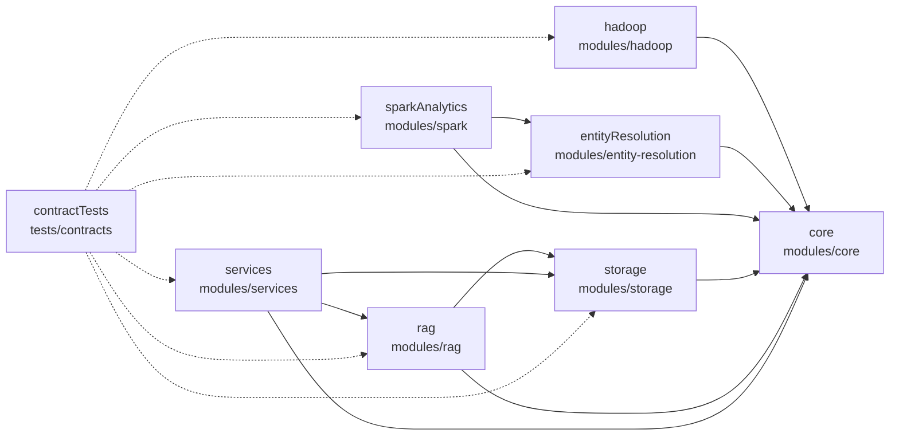
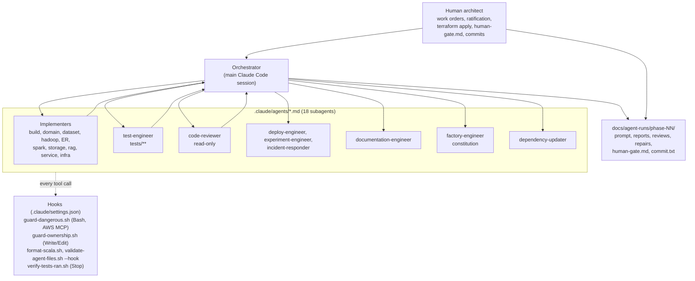
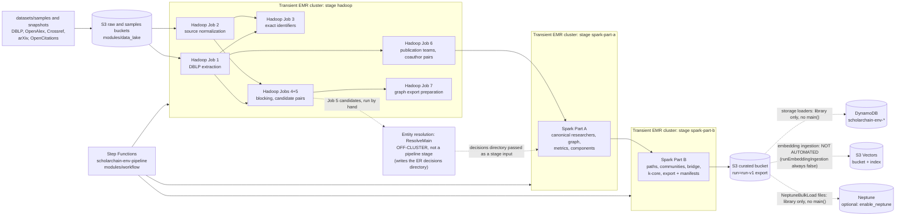
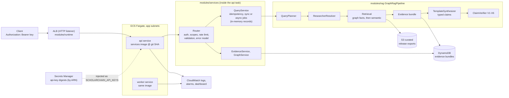
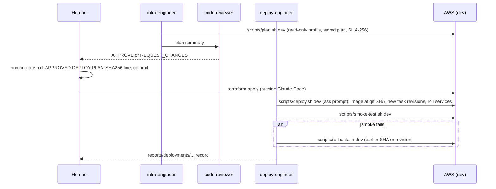

# ScholarChain architecture

Draft for Phase 17, written from repository state at commit `0c82710`. Every box below names the
source file or Terraform module it comes from. Measured behavior (latency, scaling, counts) is not
part of this document: PENDING (Phase 15) and PENDING (Phase 16).

## 1. Module graph (build.sbt)

The sbt projects are defined in `build.sbt` (lines 149-269 at `0c82710`). Allowed dependencies are
the table in `CLAUDE.md` ("Module dependency boundaries").

Dashed edges: the cross-module test project may depend on any module; nothing depends on it.

## 2. Build-time architecture: the agentic factory

How the code itself was produced (docs/agents.md sections 1, 4, 5, 10).

Subagents never invoke one another (no agent is granted the Agent or Task tool; the validator rejects
it). Findings go back through the orchestrator to the owning agent.

## 3. Build-time architecture: the batch data pipeline

Sources: `infra/terraform/modules/workflow` (Step Functions state machine
`scholarchain-<env>-pipeline`, SQS jobs queue and DLQ), `scripts/run-bounded-pipeline.sh` (stages),
`modules/hadoop` (Jobs 1-7, `DblpPipelineMain`, `SourcePipelineMain`), `modules/entity-resolution`,
`modules/spark` (`PartA`, `PartB`, `PartBMain`), `modules/storage` (loaders), and
`infra/terraform/modules/{data_lake,dynamodb,vectors,neptune}`.

Solid edges are automated by `scripts/run-bounded-pipeline.sh` and the state machine. Dashed edges
are steps that exist only as library code or as an optional Terraform state, with no automated
entrypoint at `0c82710` (details below the diagram).

Stage order as encoded in `scripts/run-bounded-pipeline.sh` (header lines 19-27): `hadoop` (step 1
`DblpPipelineMain`, Job 1 then Job 6; step 2 `SourcePipelineMain`, Jobs 2, 3, 4+5, 7), then
`spark-part-a` (`PartAMain`), then `spark-part-b` (`PartBMain`). These three are the only stages.
One stage runs per Step Functions execution, on its own transient cluster.

What is not automated at `0c82710` (verified in source):

| Step | State | Evidence |
|---|---|---|
| Entity resolution | Not a pipeline stage. `ResolveMain` (`modules/entity-resolution`) runs off-cluster on the Job 5 candidates; its decisions directory is then passed to the `spark-part-a` stage as an input | `scripts/run-bounded-pipeline.sh` lines 25-27 |
| Embedding ingestion into S3 Vectors | Not automated. The state machine has an optional `RunEmbeddingIngestion` state, but the script always sends `"runEmbeddingIngestion": false`, and the ingestion command is empty | `scripts/run-bounded-pipeline.sh` lines 37 and 625; `infra/terraform/modules/workflow/main.tf` line 21; `infra/terraform/envs/dev/dev.tfvars.example` line 108 (`embedding_ingestion_command = []`, "empty until an ingestion entrypoint exists in code") |
| DynamoDB loads and Neptune bulk-load files | Not automated. The loaders and `NeptuneBulkLoad` exist as library code; `modules/storage/src/main` has no `main` method, `extends App`, or `@main` entrypoint, and no pipeline stage calls them | search of `modules/storage/src/main` for `def main`, `extends App`, `@main` (no matches); `storage/graph/NeptuneBulkLoad.scala`, `storage/vectors/EmbeddingIngestion.scala` |

The related hand-off gaps (export layout, Neptune not queried at runtime, semantic context not
composed) are listed in [data-lineage.md](data-lineage.md#gaps-observed-while-tracing-not-resolved-by-this-draft).

## 4. Runtime architecture

Sources: `infra/terraform/modules/runtime` (ECR, ECS cluster, task definitions `api`, `worker`,
`embedding_ingestion`, ALB, HTTP listener, ECS services `api` and `worker`),
`infra/terraform/modules/network` (VPC, public, app, and data subnets, S3 and DynamoDB gateway
endpoints, optional interface endpoints), `infra/terraform/modules/observability` (alarms and
dashboard), `modules/services` (`Main`, `ServicesApp`, `Router`), and
`modules/rag/src/main/scala/edu/uic/cs441/scholarchain/rag/runtime/`.

What is and is not wired at `0c82710` (verified in source):

| Component | State | Evidence |
|---|---|---|
| Graph facts from release exports (S3) | wired in `aws` mode | `Main.scala`, `AwsComposition.dependencies` calls `GraphExportReader.load` |
| Evidence bundles in DynamoDB | wired in `aws` mode | `AwsComposition.dependencies` passes `Some(stores.keyValue)` |
| Live Neptune queries | not wired; `UnavailableGraphStore` fails every call and readiness reports it | `Main.scala`, `object UnavailableGraphStore` |
| S3 Vectors semantic retrieval | code exists in `modules/rag` and `modules/storage`; not passed by `AwsComposition` (`semantic = None`) | `ServicesApp.scala` `Dependencies` defaults |
| Model-based synthesis | not wired; default `TemplateSynthesizer` | `ServicesApp.scala` `Dependencies` defaults; prompt files in `prompts/answer-synthesis/v1/` |
| Fixture mode | `SCHOLARCHAIN_RUNTIME_MODE=fixture` serves the synthetic `LocalFixture` release | `Main.scala`; Terraform `runtime_mode` (`infra/terraform/envs/dev/variables.tf`) |
| SQS consumer in services | none found in `modules/services/src/main` (no SQS reference); async jobs run in the in-process `workflow` worker pool | `ServicesApp.scala` (`WorkerPool("workflow", ...)`) |
| Optional OpenSearch tier | not implemented | no OpenSearch reference under `modules/` or `infra/` |

## 5. Deployment path

Phase 14 deviation (recorded in `docs/agent-runs/phase-14/human-gate.md`): the human ran `deploy.sh`
and `smoke-test.sh` personally, and deploy-engineer verifies read-only and writes the report. That
report is [reports/deployments/2026-11-24-dev-phase-14.md](../reports/deployments/2026-11-24-dev-phase-14.md)
(written after `0c82710`, not yet committed).

## 6. Threats and limits

See [threat-model.md](threat-model.md). Verified service limits and Region availability:
`docs/service-limits.md`, PENDING (not written in this draft).
