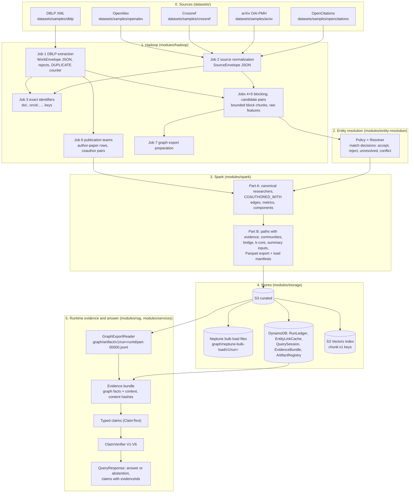

# ScholarChain data lineage

Draft for Phase 17, traced through the code at commit `0c82710`: source dataset, Hadoop output,
entity resolution, Spark output, stores, evidence, and answer. Record counts, run IDs, and output
prefixes of real runs: PENDING (Phase 15). Quality of each step (precision, recall, groundedness):
PENDING (Phase 16).

## Provenance rule

Every transformed record keeps the source dataset, the source record ID, and the pipeline run ID
(`CLAUDE.md` law 3). Core validation rejects a record whose wire form lacks a `provenance` object
(`modules/core/src/main/scala/edu/uic/cs441/scholarchain/core/validation/Validators.scala`,
`MissingProvenance`). Stable IDs and content hashes come from `core/ids/StableIds.scala` and
`core/ids/CanonicalHash.scala`; record shapes from `core/model/Records.scala`; run manifests from
`core/model/RunManifest.scala`.

## End-to-end view

## Step by step

| Step | Input | Code | Output and provenance carried |
|---|---|---|---|
| 0 Sources | committed bounded samples and snapshot metadata | `datasets/dataset-manifest.yaml`, `datasets/schemas/*.md`, `datasets/samples/SHA256SUMS`, `datasets/scripts/` | raw files with checksums; license and snapshot recorded in the manifest |
| 1a Job 1 | DBLP XML; records never split across mappers | `hadoop/DblpXmlInputFormat.scala`, `DblpRecordParser.scala`, `Jobs.scala` (`DblpExtractMapper`) | `WorkEnvelope` JSON per work, deduplicated by work key (duplicates counted), rejected records in a versioned reject output |
| 1b Job 2 | OpenAlex, Crossref, arXiv, OpenCitations files (source taken from file name or folder) | `hadoop/SourceJobs.scala` (`SourceNormalizeMapper`), `SourceNormalizers.scala` | `SourceEnvelope` JSON |
| 1c Job 3 | Job 1 and Job 2 main outputs | `SourceJobs.scala` (`ExactIds`), `Blocking.scala` | every distinct record per exact identifier key (`doi:10.x/y`, ...) |
| 1d Jobs 4+5 | Job 1 and Job 2 main outputs | `SourceJobs.scala` (`BlockKeys`), `Blocking.scala` | blocks keyed by normalized name or title, split into bounded chunks above `maxBlockSize`; candidate pairs with raw features and both records |
| 1e Job 6 | Job 1 main output | `Jobs.scala` (`TeamReducer`), `Teams.scala` | author-paper rows and coauthor pairs per work, with an oversize-team threshold |
| 1f Job 7 | Hadoop outputs | `SourceJobs.scala` (`ExportKeys`, `Export`) | partitioned graph export inputs for Spark |
| 2 Entity resolution | candidate pairs (`HadoopCandidates.scala`) | `er/Features.scala`, `Policy.scala`, `Resolver.scala`, `Outputs.scala`, `Evaluator.scala` | match decisions with policy version; identifier conflicts become conflict outputs, never silent merges |
| 3a Spark Part A | Job 1 and Job 6 named outputs and the ER output directory (`PartAInputs`) | `spark/PartA.scala`, `ConnectedComponents.scala`, `GraphAlgorithms.scala` | canonical researchers, consolidated undirected `COAUTHORED_WITH` edges, metrics, components; `params.json`, counts, invariant results; the run ID names the output directory |
| 3b Spark Part B | one committed Part A run directory | `spark/PartB.scala` (`PartBMain`), `ConstrainedClosure.scala` | `run=<run-v1>/export/<table>/graphWindow=<s>-<e>/` Parquet plus `export/manifests/<target>.json`, `manifest.json`, `params.json`, `counts.json`, `invariants.json`; every row's provenance names the Part B run, and manifests carry the Part A run ID and invariant results; an existing run directory fails the run |
| 4a Neptune files | core records | `storage/graph/NeptuneBulkLoad.scala` | openCypher CSV for Researcher, Work, `AUTHORED`, `COAUTHORED_WITH` under `graph/neptune-bulk-load/v1/run=<runId>/`, plus `evidence/coauthored-with.jsonl` with supporting work IDs and provenance |
| 4b DynamoDB | run, reject, link, session, evidence, artifact records | `storage/kv/Tables.scala`, `DynamoDbKeyValueStore.scala` | keys `RUN#`, `MENTION#`, `SESSION#`, `BUNDLE#`, `ARTIFACT#`; conditional writes; rejects stored with their own provenance digest, never dropped |
| 4c S3 Vectors | embedding records | `storage/vectors/EmbeddingIngestion.scala`, `VectorLoader.scala`, `S3VectorsStore.scala`; text from `rag/semantic/*` | `chunk:v1` keys with validated metadata; conflicting duplicates rejected and recorded as `REJECT#vector:` items |
| 5a Runtime facts | release exports in S3 | `rag/runtime/GraphExports.scala` (`GraphExportReader`) | in-memory release view; every row carries its run ID, window, and policy or algorithm version; a row that fails validation fails the load |
| 5b Evidence | graph facts, optional semantic context | `rag/runtime/Retrieval.scala`, `Evidence.scala` | bounded evidence bundle with content hashes; stored as `BUNDLE#<bundleId>` in DynamoDB in `aws` mode |
| 5c Answer | bundle | `rag/runtime/Synthesis.scala`, `ClaimVerifier.scala`, `GraphRagPipeline.scala`; `services/app/Presenter.scala` | typed claims, each verified against in-bundle evidence; unsupported claims labeled and excluded from the answer text; abstention when nothing verifies; `GET /v1/evidence/{id}` returns source dataset, source record ID, run ID, and text hash |

## Gaps observed while tracing (not resolved by this draft)

- **Export layout hand-off.** Spark Part B writes Parquet under `run=<run-v1>/export/...`, while
  `GraphExportReader` reads JSON Lines at `graph/<artifact>/v1/run=<runId>/part-00000.jsonl`. This
  draft did not find, in `modules/*/src/main`, the step that writes the `graph/<artifact>/v1/` JSON
  Lines objects: the reader builds its key with `ObjectKey.versioned(S3Prefix.Graph, ...)`, and the
  only other use of `S3Prefix.Graph` in main sources is `NeptuneBulkLoad` (a different artifact,
  `neptune-bulk-load`). The producer may live outside `modules/` or be a Phase 15 step. Owner to
  confirm: spark-engineer or storage-engineer (routed by the orchestrator).
- **Neptune is not queried at runtime.** Bulk-load files are generated, but the services compose
  `UnavailableGraphStore` in `aws` mode (`services/Main.scala`).
- **Semantic context is not composed at runtime** (`AwsComposition` leaves `semantic = None`), so
  S3 Vectors data does not reach deployed answers at `0c82710`.

## Worked trace

A concrete trace of one DBLP record from source line to answer claim, with its real run IDs and
evidence IDs: PENDING (Phase 15).
